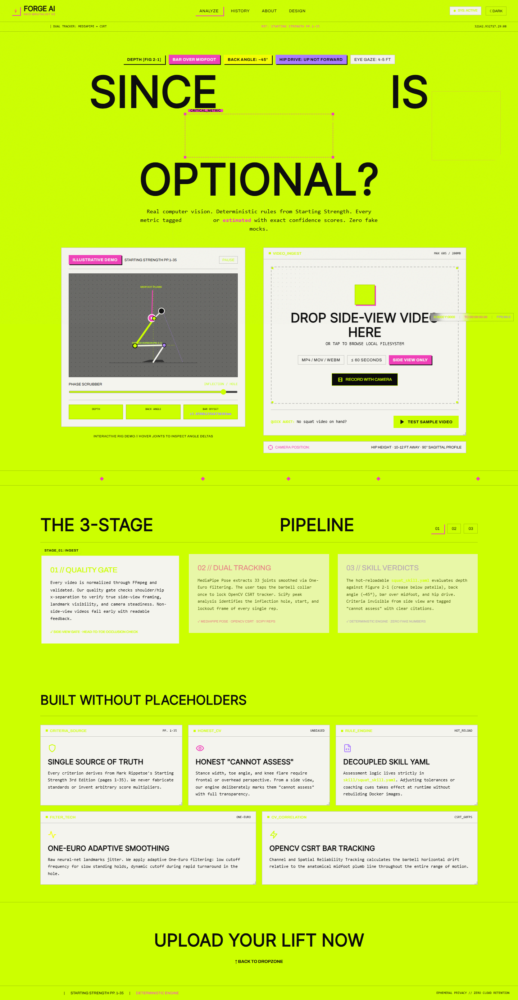
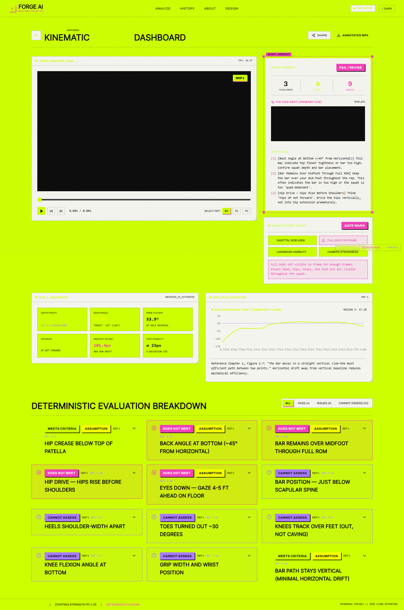
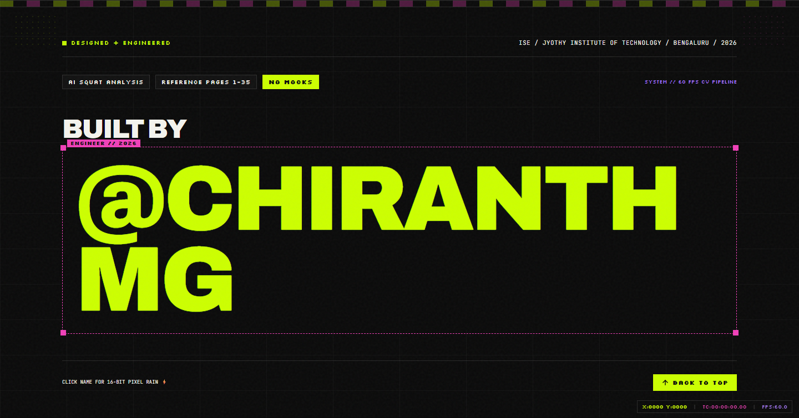
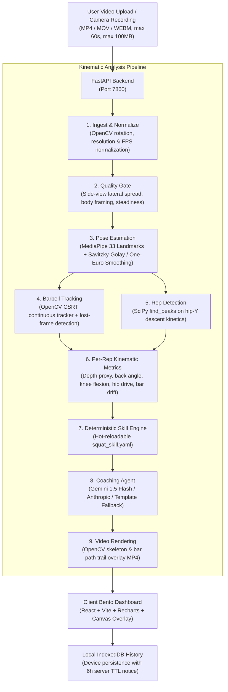

# FORGE — AI Squat Analyser

<p align="center">
  
</p>

<p align="center">
  <strong>Production-grade, evidence-grounded computer-vision app for barbell squat kinematics.</strong><br>
  Built with MediaPipe, OpenCV CSRT, SciPy, FastAPI, React 18, Tailwind CSS, Framer Motion, and Lenis.
</p>

<p align="center">
  <a href="#quickstart">Quickstart</a> •
  <a href="#neo-brutalist-design-system">Design System</a> •
  <a href="#architecture">Architecture</a> •
  <a href="#evidence--verification">Evidence & Verification</a> •
  <a href="#skill-specification">Skill Specification</a> •
  <a href="#documentation">Documentation</a>
</p>

---

## Visual Previews (Neo-Brutalist Design System)

| Landing Hero & Illustrative Demo | Design System Showcase (`/design`) |
| :---: | :---: |
|  |  |

| Real Video Kinematic Results (`/results/:id`) | Kinetic Footer Credit (`@Chiranth MG`) |
| :---: | :---: |
|  |  |

---

## Overview

Forge is an AI squat analysis system that assesses lifters against the definitive standard of strength training: **pages 1–35 of the Starting Strength reference chapter**.

Unlike black-box fitness apps that invent ungrounded scores or hallucinate precision, Forge operates on strict engineering honesty:
- **Deterministic Assessment:** Kinematic measurements are evaluated against rules defined in [`skill/squat_skill.yaml`](skill/squat_skill.yaml).
- **Honest Uncertainty:** Every metric is explicitly tagged as **Observed** (direct 2D vector calculation) or **Estimated** (proxy for 3D anatomy). Criteria invisible from a side view (such as stance width, toe angle, and knee valgus) produce an explicit `cannot assess` status.
- **Auditable Citations:** Every finding cites the exact page, figure, and section from the reference literature.
- **Scoped AI Coaching:** LLMs (Gemini / Anthropic / local template) only write motivating coaching prose. They are strictly forbidden from modifying verdicts or hallucinating thresholds.

---

## Neo-Brutalist Design System (Pixel-Grid x Kinetic Type)

- **Color Tokens:**
  - Acid Lime: `#CCFF00`
  - Signal Yellow: `#F5FF00`
  - Hot Magenta: `#F040B8`
  - Violet: `#A97BFF`
  - Ink: `#0A0A0A`
  - Paper: `#F4F4EE`
- **Typography:**
  - Display: `Archivo` 900 heavy grotesk with Roman/Italic mixing (fluid `clamp()` sizes up to ~18vw).
  - Pixel Accent: `Silkscreen` for badges, tags, and micro numbers.
  - Mono: `JetBrains Mono` for live kinematic metrics and timestamps.
- **Components (`/frontend/src/ui`):**
  - `SelectionBox`: Figma-style dashed border with 4 solid square corner handles and eyebrow label chips.
  - `PixelTile`: 12-col bento grid tile with 1px hairline border, subtle spring 3D tilt, and pixel-stair corners.
  - `TagChip`: 1px outline pixel tag chips with drag support.
  - `DotMatrix`: SVG dot pattern clusters with cursor-reactive illumination.
  - `MarqueeTicker`: Infinite pixel-font criteria marquee ticker reacting to scroll velocity.
  - `KineticHeading`: Giant kinetic typography with per-character stagger and roman/italic word swapping.
  - `CursorLabel`: Neon pointer arrow with reactive hover label pill ("UPLOAD", "PLAY", "JUMP TO FRAME") and corner coordinates readout.
  - `IllustrativeSquatDemo`: Stick-figure squat loop with real-time calculated angles, patellar horizon, and joint angle tooltips.
- **Easter Egg:**
  - Konami code listener (`↑↑↓↓←→←→BA`) toggles inverted palette and visual pixel rain.

Explore the complete component library at the live `/design` route!

---

## System Architecture



---

## Quickstart (One-Click)

### Automated Windows Launcher:
Double-click `start.bat` in the root folder! It launches both the FastAPI backend and the Vite frontend in dedicated terminal windows and automatically opens `http://localhost:5173`.

### Manual Startup:
```bash
# Terminal 1 - Backend:
set PYTHONPATH=backend
python -m uvicorn app.main:app --host 0.0.0.0 --port 7860

# Terminal 2 - Frontend:
cd frontend
npx vite --host --port 5173
```

---

## Verification & Test Suite

Run the full end-to-end automated verification script:
```bash
python backend/tests/verify_and_generate_evidence.py
```
- Tests real side-view barbell squat video (`common_sample_squat.mp4` / `squat_clip_15s.mp4`)
- Validates 5 detected reps with exact start, bottom, and lockout frames
- Tests quality-gate rejection on front-view video (`hard_front_view.mp4`)
- Tests hot-reloading of `skill/squat_skill.yaml` without application restart.

All 27 pipeline unit tests:
```bash
$env:PYTHONPATH="backend"
pytest backend/tests/test_pipeline.py -v
```

---

## Documentation
- [`docs/BUILD_NOTE.md`](docs/BUILD_NOTE.md): Architecture decisions, design token migration, trade-offs, and verification logs.
- [`docs/EVIDENCE.md`](docs/EVIDENCE.md): Visual proof, frame extracts, and criteria alignment.
- [`docs/AI_USAGE.md`](docs/AI_USAGE.md): Scoped AI coaching architecture and prompt engineering.
- [`docs/DEMO_SCRIPT.md`](docs/DEMO_SCRIPT.md): Step-by-step walkthrough for evaluating the live system.
