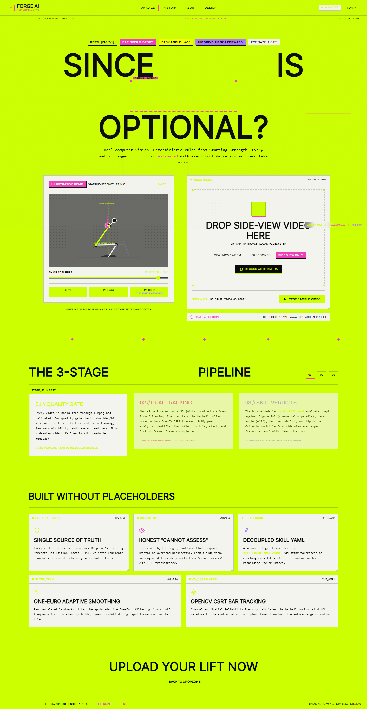
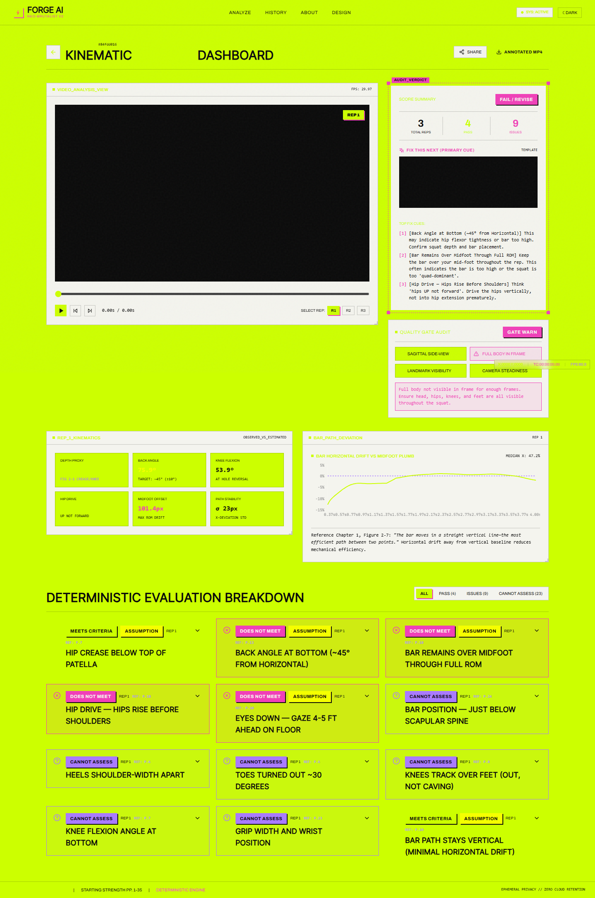
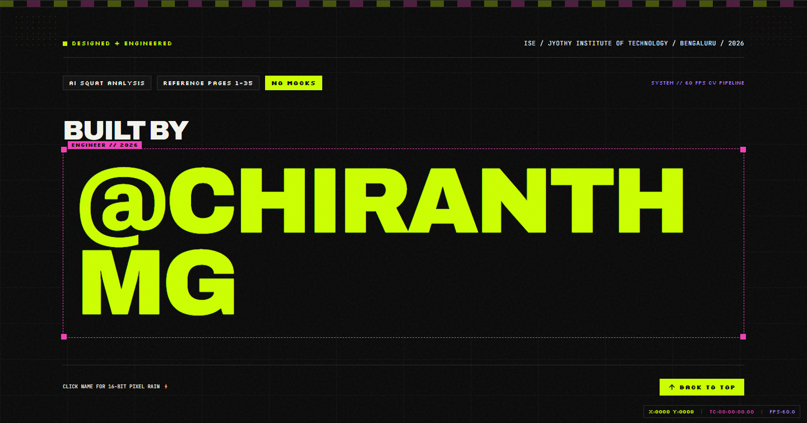
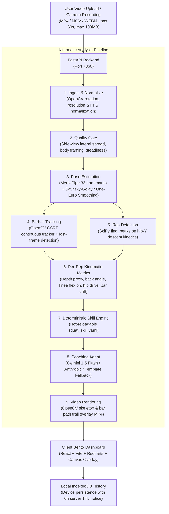

 <div align="center">


# 🏋️ FORGE
### AI Squat Analyser

**Production-grade, evidence-grounded computer vision for barbell squat kinematics.**


[🚀 **Live App**](https://forge-squat-analyzer.onrender.com) · [❤️ Health](https://forge-squat-analyzer.onrender.com/health) · [📘 API Docs](https://forge-squat-analyzer.onrender.com/docs)

[Quickstart](#-quickstart) · [Design System](#-neo-brutalist-design-system) · [Architecture](#-architecture) · [Verification](#-verification--tests) · [Docs](#-documentation)

</div>

---

## 📸 Visual Previews

<table>
<tr>
<td align="center" width="50%"><b>Landing Hero & Illustrative Demo</b><br></td>
<td align="center" width="50%"><b>Design System Showcase (<code>/design</code>)</b><br></td>
</tr>
<tr>
<td align="center"><b>Real Video Kinematic Results (<code>/results/:id</code>)</b><br></td>
<td align="center"><b>Kinetic Footer Credit (<code>@Chiranth MG</code>)</b><br></td>
</tr>
</table>

---

## 🎯 Overview

Forge assesses lifters against the definitive standard of strength training: **pages 1–35 of the *Starting Strength* squat chapter**.

Unlike black-box fitness apps that invent ungrounded scores, Forge runs on strict engineering honesty:

| | Principle | What it means |
|---|---|---|
| ⚙️ | **Deterministic Assessment** | Measurements are judged against rules in [`skill/squat_skill.yaml`](skill/squat_skill.yaml) |
| 🔍 | **Honest Uncertainty** | Every metric is tagged **Observed** (direct 2D vector) or **Estimated** (proxy for 3D anatomy). Things invisible from the side (stance width, toe angle, knee valgus) return `cannot assess` |
| 📖 | **Auditable Citations** | Every finding cites the exact page, figure and section |
| 🤖 | **Scoped AI Coaching** | LLMs (Gemini / Anthropic / local template) write coaching prose only. They can never change verdicts or invent thresholds |

---

## 🎨 Neo-Brutalist Design System

*Pixel-Grid × Kinetic Type*

### Color Tokens

| Swatch | Name | Hex |
|:---:|---|---|
|  | Acid Lime | `#CCFF00` |
|  | Signal Yellow | `#F5FF00` |
|  | Hot Magenta | `#F040B8` |
|  | Violet | `#A97BFF` |
|  | Ink | `#0A0A0A` |
|  | Paper | `#F4F4EE` |

### Typography

- **Display:** `Archivo` 900, heavy grotesk with Roman/Italic mixing (fluid `clamp()` up to ~18vw)
- **Pixel Accent:** `Silkscreen` for badges, tags and micro numbers
- **Mono:** `JetBrains Mono` for live metrics and timestamps

### Components (`/frontend/src/ui`)

| Component | Description |
|---|---|
| `SelectionBox` | Figma-style dashed border, 4 solid square corner handles, eyebrow label chips |
| `PixelTile` | 12-col bento tile, 1px hairline border, spring 3D tilt, pixel-stair corners |
| `TagChip` | 1px outline pixel tag chips with drag support |
| `DotMatrix` | SVG dot clusters with cursor-reactive illumination |
| `MarqueeTicker` | Infinite pixel-font criteria ticker reacting to scroll velocity |
| `KineticHeading` | Giant type with per-character stagger and roman/italic swaps |
| `CursorLabel` | Neon pointer with hover pills (`UPLOAD`, `PLAY`, `JUMP TO FRAME`) and coordinate readout |
| `IllustrativeSquatDemo` | Stick-figure squat loop with live angles, patellar horizon and joint tooltips |

> 🥚 **Easter Egg:** enter the Konami code `↑ ↑ ↓ ↓ ← → ← → B A` for an inverted palette and pixel rain.

Explore everything live at the [`/design`](https://forge-squat-analyzer.onrender.com/design) route.

---

## 🧠 Architecture



---

## ⚡ Quickstart

### 🪟 One-Click (Windows)

Double-click **`start.bat`** in the root folder. It launches the FastAPI backend and Vite frontend in separate terminals and opens `http://localhost:5173`.

### 🛠️ Manual

```bash
# Terminal 1 — Backend
set PYTHONPATH=backend
python -m uvicorn app.main:app --host 0.0.0.0 --port 7860

# Terminal 2 — Frontend
cd frontend
npx vite --host --port 5173
```

---

## ✅ Verification & Tests

**End-to-end evidence script**

```bash
python backend/tests/verify_and_generate_evidence.py
```

- ✔️ Real side-view barbell squat (`common_sample_squat.mp4` / `squat_clip_15s.mp4`)
- ✔️ 5 detected reps with exact start, bottom and lockout frames
- ✔️ Quality-gate rejection on front-view video (`hard_front_view.mp4`)
- ✔️ Hot-reload of `skill/squat_skill.yaml` with no restart

**Unit tests (27)**

```bash
$env:PYTHONPATH="backend"
pytest backend/tests/test_pipeline.py -v
```

---

## 📚 Documentation

| Doc | Contents |
|---|---|
| [`BUILD_NOTE.md`](docs/BUILD_NOTE.md) | Architecture decisions, design token migration, trade-offs, verification logs |
| [`EVIDENCE.md`](docs/EVIDENCE.md) | Visual proof, frame extracts, criteria alignment |
| [`AI_USAGE.md`](docs/AI_USAGE.md) | Scoped AI coaching architecture and prompt engineering |
| [`DEMO_SCRIPT.md`](docs/DEMO_SCRIPT.md) | Step-by-step walkthrough for evaluating the live system |

---

<div align="center">

**Built with 💪 by [Chiranth MG](https://github.com/cmg633)**

</div>
